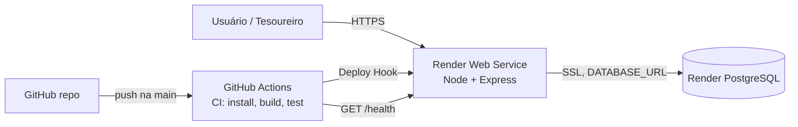

## Nuvem

### 1. URL do sistema
**https://PREENCHER.onrender.com** (health check: `/health`)

### 2. Provedor e serviços (modelo de serviço)
| Componente | Serviço | Modelo | Justificativa |
|---|---|---|---|
| Backend (API Node/Express) | Render Web Service | PaaS | Só enviamos o código; o provedor cuida de SO, runtime, HTTPS e reinício. |
| Banco de dados | Render PostgreSQL | PaaS (banco gerenciado) | Backups, patches e disponibilidade ficam com o provedor. |
| Código e pipeline | GitHub + GitHub Actions | SaaS | Usamos como serviço pronto, sem administrar servidor. |
| Armazenamento de objetos | Não utilizado | n/a | O sistema não recebe arquivos (só registra despesas). |

**Modelo de implantação:** nuvem pública, pois usamos infraestrutura compartilhada do provedor, sem custo fixo e sem hardware próprio, adequado ao porte do projeto.

### 3. Arquitetura

### 4. Pipeline
- `.github/workflows/ci.yml`: a cada push e PR roda `npm ci`, build e `npm test`.
- `.github/workflows/deploy.yml`: quando o CI passa na `main`, chama o Deploy Hook do Render e depois confere `/health`.
- Execuções: aba **Actions** do repositório.

### 5. Refazer o deploy do zero
1. Criar conta no Render e conectar o GitHub.
2. New > Blueprint > selecionar este repositório (lê o `render.yaml`).
3. Executar `banco/schema.sql` e `banco/dados-iniciais.sql` no banco criado.
4. Cadastrar os secrets `RENDER_DEPLOY_HOOK_URL` e `APP_URL` no GitHub.
5. Fazer push na `main`.

### 6. Variáveis de ambiente (ver `.env.example`)
| Variável | Descrição |
|---|---|
| `NODE_ENV` | `development` ou `production` |
| `PORT` | Porta (o Render define sozinho) |
| `DATABASE_URL` | String de conexão do Postgres |
| `DATABASE_SSL` | `true` em produção |

Secrets do GitHub: `RENDER_DEPLOY_HOOK_URL`, `APP_URL`.

### 7. Logs e verificação de saúde
- Logs: painel do Render > serviço > **Logs**.
- Saúde: `GET /health` retorna `{"status":"ok"}`; o Render usa essa rota como health check e o pipeline também confere após o deploy.

### 8. Estimativa de custos (calculadora/preços do provedor)
| Cenário | Web Service | Postgres | Total/mês |
|---|---|---|---|
| Atual (~50 usuários) | PREENCHER | PREENCHER | PREENCHER |
| 10x (~500 usuários) | PREENCHER | PREENCHER | PREENCHER |

> Anexar prints da página de preços no relatório.

### Escalabilidade
Vertical: trocar para um plano com mais CPU/RAM. Horizontal: aumentar o número de instâncias do serviço (planos pagos). Como a API não guarda estado em memória, ela pode rodar em várias instâncias; o gargalo tende a ser o banco, que pode subir de plano ou ganhar réplica de leitura.

### Segurança (menor privilégio)
Usuário do banco exclusivo da aplicação (`caixa_app`); secrets só no GitHub Actions e nas variáveis do Render; o workflow usa `permissions: contents: read`; o Deploy Hook só dispara deploy deste serviço.
