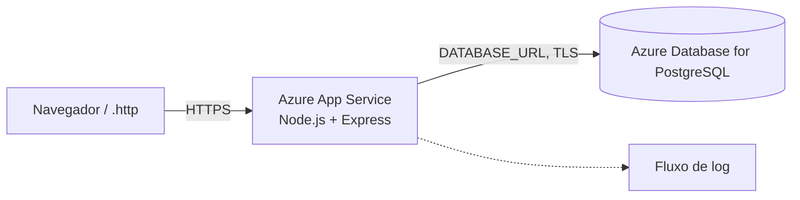

# Planejamento (Ponto de controle 1)

## Problema e usuário
A associação de moradores presta contas todo mês, mas as despesas ficam em caderno e os totais são somados na calculadora, então "não fecha" por centavos. O usuário é o(a) tesoureiro(a), que precisa registrar despesas e emitir totais exatos por categoria e período.

## Arquitetura

Caminho de uma requisição: navegador → App Service (rota, validação) → consulta parametrizada → PostgreSQL → resposta JSON.

## Modelo de dados
`despesas(id, descricao, valor NUMERIC(10,2) CHECK >0, categoria CHECK, data_despesa DATE, conferida BOOLEAN, criada_em TIMESTAMPTZ)`
Restrições: NOT NULL, CHECK (valor > 0), CHECK (categoria IN ...). Script em `banco/schema.sql`.

## Rotas
| Método | Rota | Função | Erros |
|---|---|---|---|
| GET | /health | Testa conexão com o banco, devolve `iniciado_em` | 503 |
| POST | /api/despesas | Cadastrar (RF1) | 400 |
| GET | /api/despesas?de&ate&categoria | Listar (RF2) | 400 |
| GET | /api/totais?de&ate | Totais por categoria + geral via SUM/GROUP BY (RF3) | 400 |
| PATCH | /api/despesas/:id/conferir | Marcar conferida (RF4) | 404, 409 |
| PUT | /api/despesas/:id | Editar (RF5) | 400, 404, 409 |
| DELETE | /api/despesas/:id | Excluir (RF4) | 404, 409 |

## Decisões a justificar
- **NUMERIC × FLOAT:** 0.1 + 0.2 ≠ 0.3 em ponto flutuante; dinheiro exige decimal exato.
- **Somar no SQL:** `SUM ... GROUP BY` no banco; o driver devolve NUMERIC como texto, então não converter para número.
- **Categorias em CHECK:** simples e suficiente; tabela própria seria mais flexível.
- **Fuso:** "hoje" = data de Brasília (America/Recife); documentar no README.
- **API recebe ponto decimal** (12.50); vírgula só na interface.

## Quem faz o quê
| Papel | Pessoas | Responde por |
|---|---|---|
| DEV | Hugo Pires, Zaion | Rotas, validação, regras (conferida), interface |
| DADOS | Israel Soares, Isack Otavio | schema, restrições, consultas de totais, prova de persistência |
| NUVEM | Pedro Lucas | Resource group, App Service, PostgreSQL, variáveis, firewall, deploy, logs |
| QA | João Victor, Alef Rafael | Casos de teste, evidências, README, pitch |

## Critérios de aceitação (viram testes)
CA1 valor 0, −5 ou 12,345 → 400 · CA2 data futura → 400 · CA3 10,10+20,20+0,70 = 31,00 · CA4 período inclusivo (de/até) · CA5 editar conferida → 409
